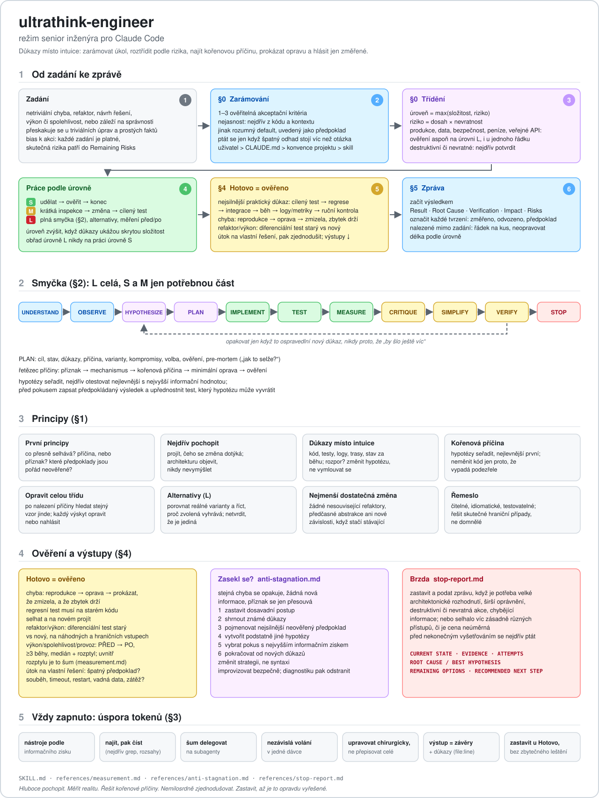

# ultrathink-engineer

[English](README.md) | Česky

Skill pro Claude Code (funguje i v Codexu a Groku): režim senior inženýra pro netriviální práci s kódem – hledání kořenové příčiny, architektura, implementace, testy, výkon a zjednodušení. Řídí se důkazy a nic neprohlásí za hotové bez ověření.



## Instalace

```bash
git clone https://github.com/mkajnar/ultrathink-engineer ~/.claude/skills/ultrathink-engineer
```

Spuštění: `/ultrathink-engineer <úkol>`. Claude ho použije i sám, když úkol odpovídá popisu ve frontmatteru `SKILL.md`.

## Obsah

| Soubor | Co |
|---|---|
| `SKILL.md` | Framing a triage (S/M/L podle složitosti a rizika), principy, smyčka, token economy, checklist hotovo, formát reportu |
| `references/measurement.md` | Co měřit před a po změně |
| `references/anti-stagnation.md` | Postup, když se stejná chyba opakuje |
| `references/stop-report.md` | Formát zastavení a předání rozhodnutí |
| `docs/` | Schéma fungování skillu (SVG, česky a anglicky) |

## Historie verzí

Historie gitu obsahuje všechny verze nalezené na serveru, s původními daty souborů:

| Verze | Datum | Velikost | Změna |
|---|---|---|---|
| v1 | 2026-08-09 | 12 kB | Původní rozsáhlá verze |
| v2 | 2026-08-22 | 5,5 kB | Zhuštění |
| v3 | 2026-10-05 | 6,6 kB | Triage S/M/L, token economy, reference v `references/` |
| v4 | 2026-10-05 | 8,5 kB | Framing a akceptační kritéria, tier podle rizika, „fix the class“, diferenciální testy |

Starší verzi získáš přes `git show <commit>:SKILL.md`.
