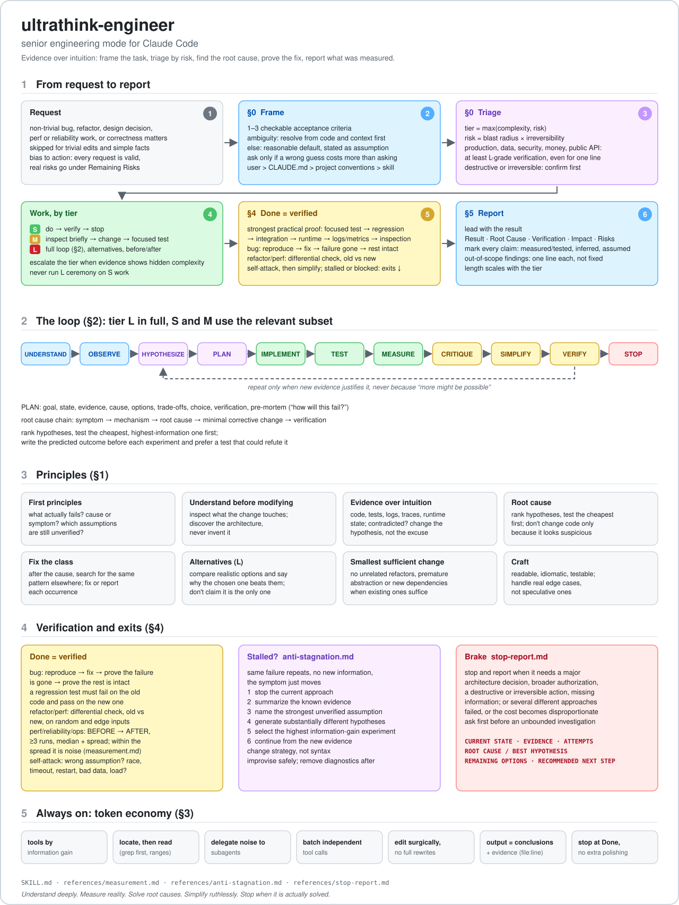

# ultrathink-engineer

English | [Česky](README-CZ.md)

A skill for Claude Code (it also works in Codex and Grok): a senior-engineer mode for non-trivial work on code: root-cause analysis, architecture, implementation, testing, performance and simplification. It is driven by evidence and declares nothing done without verification.



## Install

```bash
git clone https://github.com/mkajnar/ultrathink-engineer ~/.claude/skills/ultrathink-engineer
```

Run it with `/ultrathink-engineer <task>`. Claude also uses it on its own when a task matches the description in the `SKILL.md` frontmatter.

## Contents

| File | What |
|---|---|
| `SKILL.md` | Framing and triage (S/M/L by complexity and risk), principles, loop, token economy, done checklist, report format |
| `references/measurement.md` | What to measure before and after a change |
| `references/anti-stagnation.md` | What to do when the same failure keeps repeating |
| `references/stop-report.md` | Format for stopping and handing the decision back |
| `docs/` | Schema of how the skill works (SVG, English and Czech) |

## Version history

The git history holds every version found on the server, with the original file dates:

| Version | Date | Size | Change |
|---|---|---|---|
| v1 | 2026-08-09 | 12 kB | Original, extensive version |
| v2 | 2026-08-22 | 5.5 kB | Condensed |
| v3 | 2026-10-05 | 6.6 kB | Triage S/M/L, token economy, references moved to `references/` |
| v4 | 2026-10-05 | 8.5 kB | Framing and acceptance criteria, tier by risk, "fix the class", differential tests |

Get an older version with `git show <commit>:SKILL.md`.
